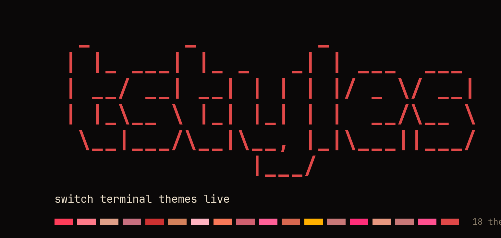
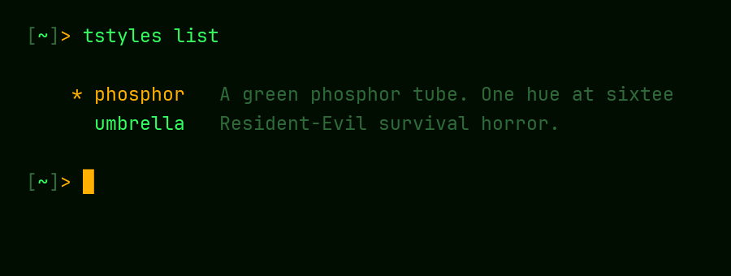

<p align="center">
  
</p>

<p align="center">
  <a href="https://github.com/fcreme/TerminalStyles/actions/workflows/test.yml"></a>
  <a href="https://hub.xerj.org/contributors/fcreme.html"></a>
  <a href="https://www.powershellgallery.com/packages/TerminalStyles"></a>
</p>

**Switch terminal themes live.** Run `tstyles`, arrow through 18 themes
previewing each one *in your current tab* — **Enter** keeps it, **Esc** reverts to
exactly how it looked before. The palette, the cursor color and the prompt
repaint instantly on any terminal that speaks OSC; on **Windows Terminal** and
**WezTerm** the font, opacity and animated background come with them. All in one
command, all non-destructive.

<p align="center">
  
</p>

Works on **Windows Terminal**, **macOS Terminal.app**, **iTerm2**, and any
terminal that speaks OSC color sequences — and in **zsh** and **bash**, not just
PowerShell. Runs on PowerShell 7 and Windows PowerShell 5.1. Keep your own prompt
(Oh My Posh / Starship) with `tstyles <name> -KeepPrompt`.

## Install

```powershell
Install-PSResource -Name TerminalStyles
Import-Module TerminalStyles -DisableNameChecking
```

On macOS and Linux this needs PowerShell first — `brew install powershell`,
or see [Requirements](https://github.com/fcreme/TerminalStyles/wiki/Install#requirements). On Windows it is already there.

Add the `Import-Module` line to your `$PROFILE` so it loads on every
new shell tab — or run `tstyles register` once and it does that for
you, with a confirm prompt first. It writes to the `$PROFILE` of each
PowerShell engine it finds on your PATH — on Windows that is pwsh 7 and
Windows PowerShell 5.1; on macOS and Linux, `pwsh` and `pwsh-preview` —
skips one that isn't installed, and writes once where two of them share
one file. The prompt names each file first. Then:

```powershell
tstyles
```

Arrow keys preview each style live, Enter keeps it, Esc cancels.

Prefer a one-line installer, or on a shell without PSResourceGet? See the
[bootstrap installer](https://github.com/fcreme/TerminalStyles/wiki/Install#alternate-bootstrap-installer).

<table>
  <tr>
    <td align="center"><b>umbrella</b><br></td>
    <td align="center"><b>eva</b><br></td>
    <td align="center"><b>ex-machina</b><br></td>
    <td align="center"><b>forest</b><br></td>
  </tr>
  <tr>
    <td align="center"><b>garden-rain</b><br></td>
    <td align="center"><b>gitbash</b><br></td>
    <td align="center"><b>golden-forest</b><br></td>
    <td align="center"><b>kitty</b><br></td>
  </tr>
  <tr>
    <td align="center"><b>lain</b><br></td>
    <td align="center"><b>marquee</b><br></td>
    <td align="center"><b>neon-rain</b><br></td>
    <td align="center"><b>rain</b><br></td>
  </tr>
  <tr>
    <td align="center"><b>snowday</b><br></td>
    <td align="center"><b>sober</b><br></td>
    <td align="center"><b>tombraider</b><br></td>
    <td align="center"><b>koholint</b><br></td>
    <td align="center"><b>skyline</b><br></td>
    <td align="center"><b>phosphor</b><br></td>
  </tr>
</table>

## Documentation

The full guide is in the [wiki](https://github.com/fcreme/TerminalStyles/wiki):

- [Install](https://github.com/fcreme/TerminalStyles/wiki/Install): PSGallery and bootstrap installs, requirements, execution policy
- [Using tstyles](https://github.com/fcreme/TerminalStyles/wiki/Using-tstyles): the picker, every subcommand, tuning, fonts, `-KeepPrompt`, `-Target`, reset
- [Styles](https://github.com/fcreme/TerminalStyles/wiki/Styles): the bundled catalog, with screenshots
- [Terminals and Shells](https://github.com/fcreme/TerminalStyles/wiki/Terminals-and-Shells): macOS, Linux, zsh and bash, what each terminal can show, WezTerm, Terminal.app, VS Code and its forks
- [Background Images](https://github.com/fcreme/TerminalStyles/wiki/Background-Images)
- [Scripting and Recovery](https://github.com/fcreme/TerminalStyles/wiki/Scripting-and-Recovery): `apply.ps1`, and getting `settings.json` back
- [Updating and Uninstalling](https://github.com/fcreme/TerminalStyles/wiki/Updating-and-Uninstalling)
- [Creating a Style](https://github.com/fcreme/TerminalStyles/wiki/Creating-a-Style)
- [Known Limitations](https://github.com/fcreme/TerminalStyles/wiki/Known-Limitations)
- [FAQ and Troubleshooting](https://github.com/fcreme/TerminalStyles/wiki/FAQ-and-Troubleshooting)

The wiki is generated from [`docs/wiki/`](docs/wiki), so changes to it go
through a pull request like any other.

## Contributing

Bug reports, feature ideas, and new themes are all welcome — see
[CONTRIBUTING.md](CONTRIBUTING.md). Themes are the easiest way in:
pitch one with a [theme idea issue](https://github.com/fcreme/TerminalStyles/issues/new/choose),
or grab a [`good first issue`](https://github.com/fcreme/TerminalStyles/labels/good%20first%20issue).

## License

MIT — see [LICENSE](LICENSE).
